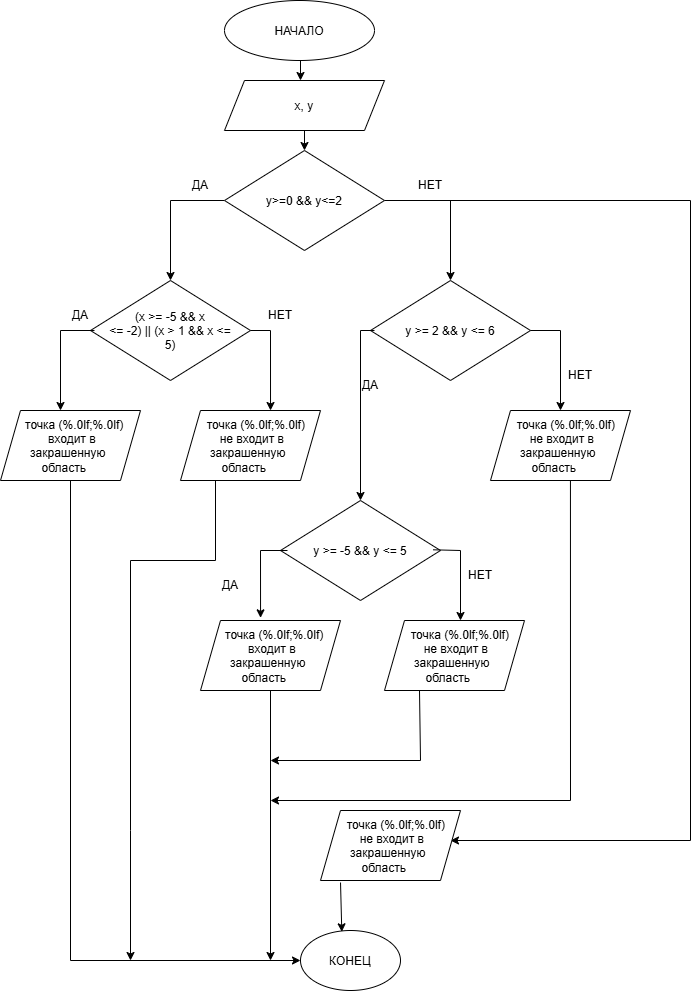

# Домашнее задание к работе 6

## Условие задачи  
Определить, попадает ли точка с координатами $(x; y)$ в заданную закрашенную область.  
Область состоит из двух частей:  
- **нижний прямоугольник**: $y \in [0; 2]$, а $x$ должен находиться либо в отрезке $[-5; -2]$, либо в полуинтервале $(1; 5]$;  
- **верхний прямоугольник**: $y \in [2; 6]$, при этом $x \in [-5; 5]$.  

Если точка находится вне этих областей — вывести сообщение, что она не входит в закрашенную область.

## 1. Алгоритм и блок-схема

### Алгоритм
1. **Начало**.
2. Установить локаль для корректного отображения кириллицы: `setlocale(LC_CTYPE, "UTF-8")`.
3. Объявить переменные:
   - `double x` — координата точки по оси X;
   - `double y` — координата точки по оси Y.
4. Вывести приглашение к вводу: `puts("Введите x и y:")`.
5. Считать значения координат: `scanf("%lf %lf", &x, &y)`.
6. Проверить попадание в нижний слой:
   - если $y \in [0; 2]$ и одновременно $x \in [-5; -2]$ **или** $x \in (1; 5]$, то точка входит;
   - иначе — не входит (для этого слоя).
7. Если не попало в нижний слой, проверить попадание в верхний слой:
   - если $y \in [2; 6]$ и $x \in [-5; 5]$, то точка входит;
   - иначе — не входит.
8. Если ни одно из условий не выполнено — точка не входит в область.
9. Вывести результат: сообщение о том, входит точка или нет, с указанием её координат.
10. **Конец**.

### Блок-схема
  

> **Важно:** чтобы картинка отобразилась на GitHub, положи файл `lab6home.png` в папку репозитория и убедись, что имя совпадает с тем, что указано в строке выше. Если картинки пока нет, можно временно оставить строку или заменить на описание схемы текстом.

---

## 2. Реализация программы

```c
#include <stdio.h>
#include <locale.h>
#include <math.h>

// Контрольные примеры:
// x=1 y=7   ---> не входит
// x=2 y=2   ---> входит
// x=222 y=2222 ---> не входит

int main()
{
    setlocale(LC_CTYPE, "UTF-8");
    double x;
    double y;

    puts("Введите x и y:");
    scanf("%lf %lf", &x, &y);

    if (y >= 0 && y <= 2)
    {
        if ((x >= -5 && x <= -2) || (x > 1 && x <= 5))
        {
            printf("точка (%.0lf;%.0lf) входит в закрашенную область", x, y);
        }
        else
        {
            printf("точка (%.0lf;%.0lf) не входит в закрашенную область", x, y);
        }
    }
    else if (y >= 2 && y <= 6)
    {
        if (x >= -5 && x <= 5)
        {
            printf("точка (%.0lf;%.0lf) входит в закрашенную область", x, y);
        }
        else
        {
            printf("точка (%.0lf;%.0lf) не входит в закрашенную область", x, y);
        }
    }
    else
    {
        printf("точка (%.0lf;%.0lf) не входит в закрашенную область", x, y);
    }

    return 0;
}
